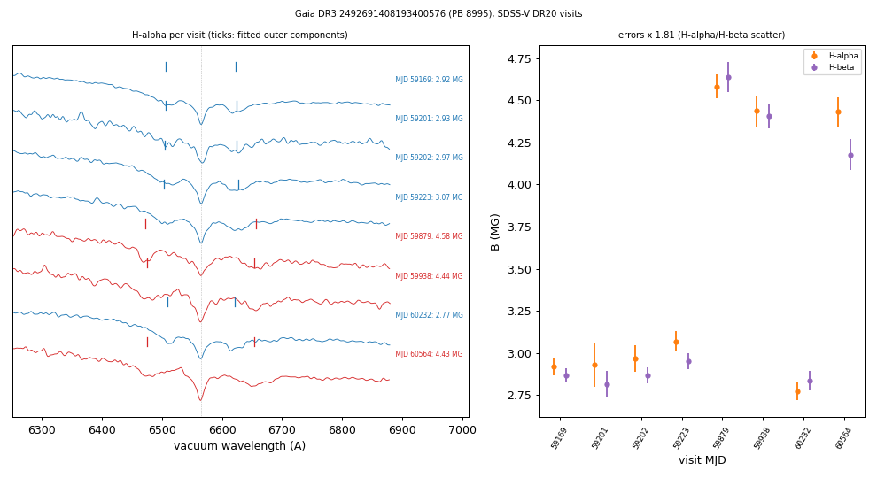
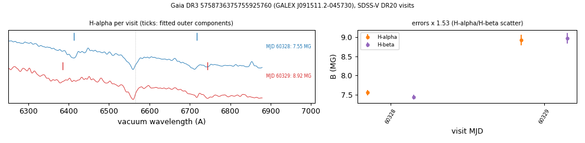

# Magnetic field strength changing between visits

Two magnetic white dwarfs whose Zeeman splitting changes between SDSS-V DR20 visits, measured the same way in H-alpha and H-beta: PB 8995 (Gaia DR3 2492691408193400576) and GALEX J091511.2-045730 (Gaia DR3 5758736375755925760). Both are catalogued magnetic white dwarfs; no report of a changing field was found for either. Per-visit fields are in `tables/field_variability_visits.csv`, the summary in `tables/field_variability.csv` (`scripts/field_variability.py`; method below and in [METHODS.md](../METHODS.md#methods)).

## Fields per visit

B is the linear-Zeeman field from the separation of the outer components (as in [zeeman.md](zeeman.md)), fitted in each in-stack visit with the XCSAO shift removed. Errors on B_Ha and B_Hb are formal; the mean field B = (B_Ha + B_Hb)/2 carries the formal error times the star's error inflation (the scatter of the H-alpha/H-beta difference across its visits).

| star | MJD | S/N | B H-alpha (MG) | B H-beta (MG) | B mean (MG) |
|---|---|---|---|---|---|
| PB 8995 | 59169 | 59.5 | 2.92 ± 0.03 | 2.87 ± 0.02 | 2.89 ± 0.03 |
| PB 8995 | 59201 | 19.2 | 2.93 ± 0.07 | 2.82 ± 0.04 | 2.87 ± 0.08 |
| PB 8995 | 59202 | 44.6 | 2.97 ± 0.04 | 2.87 ± 0.03 | 2.92 ± 0.05 |
| PB 8995 | 59223 | 40.1 | 3.07 ± 0.03 | 2.95 ± 0.03 | 3.01 ± 0.04 |
| PB 8995 | 59879 | 21.4 | 4.58 ± 0.04 | 4.64 ± 0.05 | 4.61 ± 0.06 |
| PB 8995 | 59938 | 21.7 | 4.44 ± 0.05 | 4.41 ± 0.04 | 4.42 ± 0.06 |
| PB 8995 | 60232 | 29.8 | 2.77 ± 0.03 | 2.83 ± 0.03 | 2.80 ± 0.04 |
| PB 8995 | 60564 | 26.5 | 4.43 ± 0.05 | 4.18 ± 0.05 | 4.31 ± 0.06 |
| GALEX J091511.2-045730 | 60328 | 31.9 | 7.55 ± 0.04 | 7.43 ± 0.04 | 7.49 ± 0.05 |
| GALEX J091511.2-045730 | 60329 | 30.9 | 8.92 ± 0.09 | 8.97 ± 0.09 | 8.94 ± 0.10 |

## PB 8995 (WD 0159-032)

Gaia DR3 2492691408193400576; G = 16.93, M_G = 11.13. SIMBAD WD* DAH (17 references), MWDD DAH, SDSS-V SnowWhite class DA (30.7 kK); Gentile Fusillo et al. (2021) H-atmosphere fit 19.6 kK, 0.74 Msun.
- The eight visits (2020-2024) fall into two groups, 2.80-3.01 MG (five visits) and 4.31-4.61 MG (three visits). Between the visits with the highest and lowest field, H-alpha changes by 1.81 MG and H-beta by 1.81 MG.
- chi2 of a constant field 1640 for 7 degrees of freedom after the error inflation of 1.81.
- ZTF g: highest Lomb-Scargle peak at P = 4.7057 h, false-alarm probability 6.3e-9, semi-amplitude 0.9% (456 points). ZTF r has its highest peak at the same period with false-alarm probability 0.50 (477 points).
- TESS sector 97 has 2-minute data; it was not analysed. Lawrie et al. (2013, ASP Conf. Ser. 469, 429) included the star in a photometric survey of magnetic white dwarfs; their period table was not read. No report of a changing field was found in ADS full text for five aliases.
- Test: the SDSS-V visits phased on a refined ZTF/TESS period; time-resolved spectroscopy or spectropolarimetry over one period.

## GALEX J091511.2-045730 (WDJ091511.21-045730.66)

Gaia DR3 5758736375755925760; G = 16.39, BP-RP = -0.54, M_G = 8.16. SIMBAD WD* DA, MWDD DAH, DESI DR1 class DAH (Swan et al. 2026), SDSS-V SnowWhite class DA (fit at the 120 kK grid edge); no H-atmosphere solution in Gentile Fusillo et al. (2021).
- Two visits on consecutive nights (MJD 60328 and 60329, LCO): the mean field changes from 7.49 to 8.94 MG; H-alpha by 1.37 MG and H-beta by 1.53 MG. chi2 177 for 1 degree of freedom after the error inflation of 1.53.
- Rotation: Oliveira da Rosa et al. (2024) list a TESS period of 11.468 ± 0.007 h (TIC 837076117, classified DA there). ZTF r: highest peak at 11.4531 h, false-alarm probability 3e-21 (383 points); ZTF g: highest peak at 5.7263 h, half that period, false-alarm probability 5e-14 (308 points).
- No report of a changing field was found in ADS full text for two aliases.
- Test: phase-resolved spectroscopy over the 11.5-h rotation.

## Selection

Per-visit fits were made for 259 objects with at least two in-stack visits and a magnetic label: SnowWhite magnetic classifications, an earlier list of Zeeman-split SDSS-V spectra, SnowWhite classes containing H after D (DAH, DBH and similar) and MWDD DAH. 17 of the 32 stars of [zeeman.md](zeeman.md) are among them. For 87 of the 259 a Zeeman triplet is detected in the coadd. The field variability is tested on the per-visit mean field with errors inflated by each star's H-alpha/H-beta disagreement; a star is flagged when p < 1e-4, both lines change in the same direction and each by more than 0.2 MG. The two stars here are the flagged stars with the largest, line-consistent changes and a rotation signal. White dwarfs without a magnetic label were not fitted per visit. The selection over the 259 objects is not recomputed by the scripts; `scripts/field_variability.py` fits the two stars listed here.
