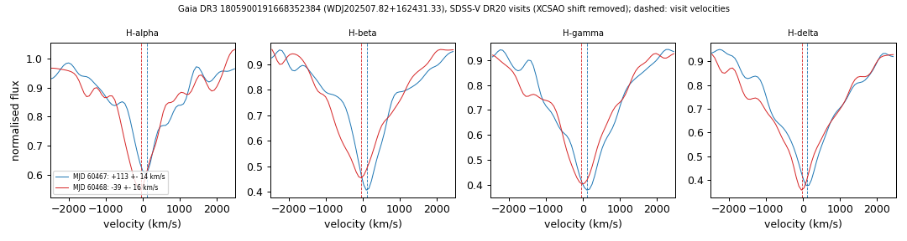

# WDJ202507.82+162431.33 (Gaia DR3 1805900191668352384)

## Radial-velocity variable DA white dwarfs (double white dwarf candidates)

DA white dwarf, G = 17.86, M_G = 8.25; no GF21 H-atmosphere solution (Pwd 0.21). Photometric extremely-low-mass candidate in Pelisoli & Vos (2019).

**Measurement.** SDSS-V visit velocities (MJD: km/s) 60467: +113 ± 14; 60468: -39 ± 16; BOSS exposures 60467.37: +103 ± 15; 60468.33: -58 ± 19; change 152 km/s (7.0 sigma); no period known.

Method and context: [rv_variable_da](../rv_variable_da.md)

Tables: [rv_variable_da.csv](../../tables/rv_variable_da.csv), [rv_variable_da_velocities.csv](../../tables/rv_variable_da_velocities.csv). Scripts: `scripts/rv_variable_da.py` (commands in the [reproduction list](../../README.md#reproduction)).

## Input data

- [data/ztf_1805900191668352384.csv](../../data/ztf_1805900191668352384.csv)

## Figures

