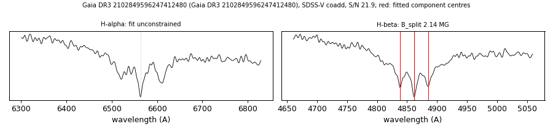

# Gaia DR3 2102849596247412480

## Zeeman splitting

DA white dwarf, G = 17.3; catalogued: SnowWhite DA; SIMBAD WD*/DA; MWDD DA. H-alpha fit unconstrained in the coadd (components blended at this field); sigma components visible near +-44 A in both visits. Zeeman triplet also in LAMOST DR11 obsid 1127102095 (2023-06-12).

**Measurement.** Zeeman-split Balmer lines: B = 2.14 ± 0.02 MG (H-beta only; H-alpha fit unconstrained); spectrum S/N 21.9.

Method and context: [zeeman](../zeeman.md)

Tables: [magnetic_zeeman.csv](../../tables/magnetic_zeeman.csv). Scripts: `scripts/zeeman_split.py` (commands in the [reproduction list](../../README.md#reproduction)).

## Figures

