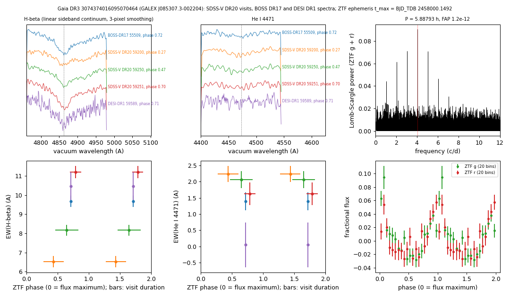

# GALEX J085307.3-002204 (Gaia DR3 3074374016095070464)

## Hydrogen and helium line strengths that change between visits

White dwarf, G = 18.798, M_G = 11.01; catalogued: SnowWhite DA (36.9 kK); SIMBAD WD* DAB; MWDD DA; DESI DR1 DA (Swan et al. 2026).

**Measurement.** Candidate double-faced white dwarf. EW(H-beta) 6.52 ± 0.29 / 8.16 ± 0.28 / 11.2 ± 0.33 A and EW(He I 4471) 2.24 ± 0.25 / 2.06 ± 0.26 / 1.63 ± 0.35 A in the SDSS-V visits of MJD 59200/59250/59251 (p_ZA = 4.8e-30, p_ZH = 2.9e-38, p_ZHe = 0.037); ZTF P = 5.88793 ± 0.00003 h, semi-amplitude 2.96%, false-alarm probability 1.2e-12.

Method and context: [line_variability](../line_variability.md)

Tables: [line_variability.csv](../../tables/line_variability.csv), [line_variability_3074374016095070464.csv](../../tables/line_variability_3074374016095070464.csv). Scripts: `scripts/line_variability.py` (commands in the [reproduction list](../../README.md#reproduction)).

## Input data

- [data/ztf_3074374016095070464.csv](../../data/ztf_3074374016095070464.csv)
- [data/ztf_3074374016095070464_neighbours_g.csv](../../data/ztf_3074374016095070464_neighbours_g.csv)

## Figures

