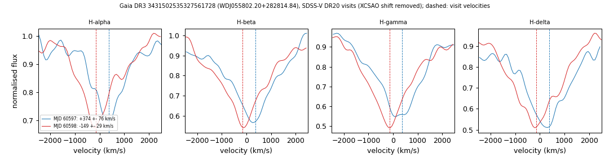

# WDJ055802.20+282814.84 (Gaia DR3 3431502535327561728)

## Radial-velocity variable DA white dwarfs (double white dwarf candidates)

DA white dwarf, G = 18.34, M_G = 9.49; GF21 H-atmosphere 18.4 kK, log g 6.88, 0.26 Msun. Photometric extremely-low-mass candidate in Pelisoli & Vos (2019).

**Measurement.** SDSS-V visit velocities (MJD: km/s) 60597: +374 ± 76; 60598: -149 ± 29; BOSS exposures 60597.42: +358 ± 54; 60598.50: -113 ± 34; change 523 km/s (6.4 sigma); no period known.

Method and context: [rv_variable_da](../rv_variable_da.md)

Tables: [rv_variable_da.csv](../../tables/rv_variable_da.csv), [rv_variable_da_velocities.csv](../../tables/rv_variable_da_velocities.csv). Scripts: `scripts/rv_variable_da.py` (commands in the [reproduction list](../../README.md#reproduction)).

## Input data

- [data/ztf_3431502535327561728.csv](../../data/ztf_3431502535327561728.csv)

## Figures

