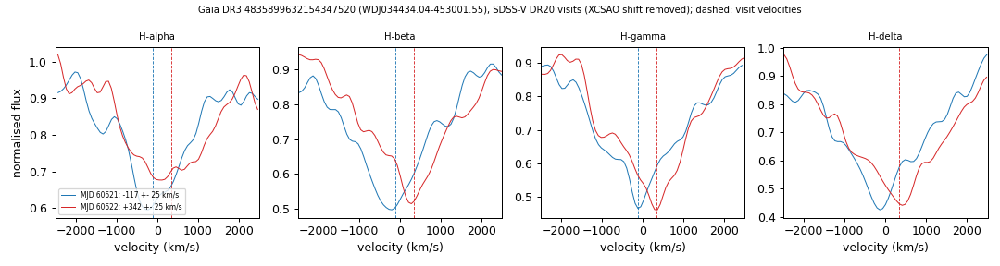

# WDJ034434.04-453001.55 (Gaia DR3 4835899632154347520)

## Radial-velocity variable DA white dwarfs (double white dwarf candidates)

DA white dwarf, G = 18.88, M_G = 10.07; GF21 H-atmosphere 12.8 kK, log g 6.99, 0.26 Msun. Photometric extremely-low-mass candidate in Pelisoli & Vos (2019).

**Measurement.** SDSS-V visit velocities (MJD: km/s) 60621: -117 ± 25; 60622: +342 ± 25; BOSS exposures 60621.29: -145 ± 52; 60621.31: -120 ± 49; 60622.22: +316 ± 62; 60622.24: +382 ± 58; change 458 km/s (12.9 sigma); no period known.

Method and context: [rv_variable_da](../rv_variable_da.md)

Tables: [rv_variable_da.csv](../../tables/rv_variable_da.csv), [rv_variable_da_velocities.csv](../../tables/rv_variable_da_velocities.csv). Scripts: `scripts/rv_variable_da.py` (commands in the [reproduction list](../../README.md#reproduction)).

## Figures

