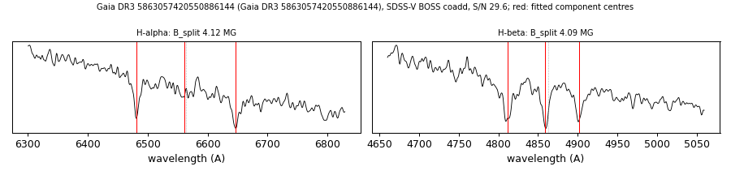

# Gaia DR3 5863057420550886144

## Zeeman splitting

DA white dwarf, G = 17.146; catalogued: SIMBAD WD*/D; MWDD DA:. Not in SnowWhite; Gaia XP-based types DA:/DC only.

**Measurement.** Zeeman-split Balmer lines: B = 4.12 ± 0.02 MG (H-alpha), 4.09 ± 0.03 MG (H-beta); spectrum S/N 29.6.

Method and context: [zeeman](../zeeman.md)

Tables: [magnetic_zeeman.csv](../../tables/magnetic_zeeman.csv). Scripts: `scripts/zeeman_split.py` (commands in the [reproduction list](../../README.md#reproduction)).

## Figures

