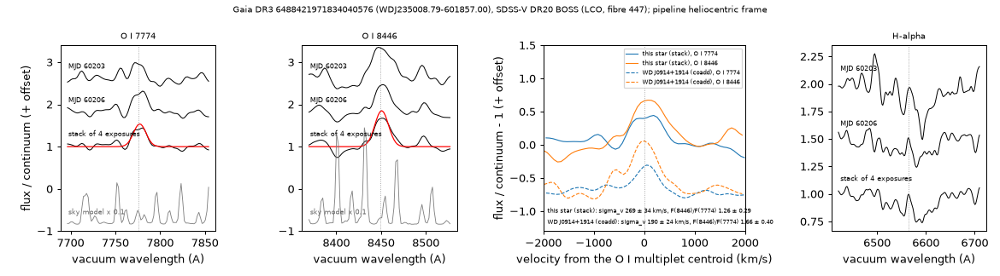

# WDJ235008.79-601857.00 (Gaia DR3 6488421971834040576)

## O I 7774 and 8446 emission

White dwarf, G = 18.795, M_G = 9.96; catalogued: SnowWhite DA (28.1 kK, p_DA 0.86, p_CV 0.01); SIMBAD WD*/DA; MWDD DA.

**Measurement.** O I 7774 and 8446 emission in each of four SDSS-V BOSS exposures (MJD 60203 and 60206; one instrument and one fibre): mean fluxes 31.7 ± 5.0 and 40.9 ± 5.3 × 10⁻¹⁷ erg s⁻¹ cm⁻², velocity dispersion 264 ± 29 km/s, wavelength ratio 1.08680 ± 0.00021 (O I: 1.08659); no spectrum from another instrument.

Method and context: [oxygen_emission](../oxygen_emission.md)

Tables: [oxygen_emission.csv](../../tables/oxygen_emission.csv), [oxygen_emission_exposures.csv](../../tables/oxygen_emission_exposures.csv). Scripts: `scripts/oxygen_emission.py` (commands in the [reproduction list](../../README.md#reproduction)).

## Input data

- [data/atlas_forced_photometry_6488421971834040576.txt](../../data/atlas_forced_photometry_6488421971834040576.txt)

## Figures

