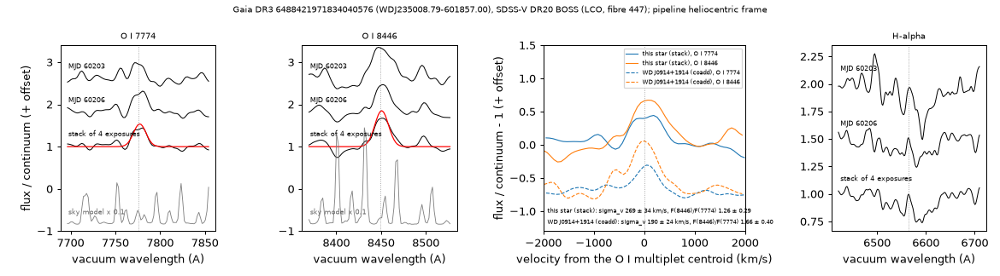

# O I 7774 and 8446 emission

Gaia DR3 6488421971834040576 (WDJ235008.79-601857.00, G = 18.8) is classified as a DA white dwarf by the SDSS-V DR20 SnowWhite pipeline (Teff 28,140 ± 400 K, log g 7.54 ± 0.06). SDSS-V observed it with the BOSS spectrograph at Las Campanas Observatory in four 900 s exposures on MJD 60203 and 60206 (2023 September 16 and 19; field 109553, fibre 447, reduction v6_2_1). Each exposure shows emission features at 7776.7 ± 1.1 Å and 8451.7 ± 1.1 Å (vacuum, heliocentric). Their wavelength ratio, 1.08680 ± 0.00021, matches that of the O I 7772-7775 Å and O I 8446 Å multiplets (1.08659), at a velocity of +78 ± 26 km/s.

Each exposure was fitted with a continuum, a scaled sky-model term and two Gaussians of common velocity and width. The mean line fluxes over the four exposures are (31.7 ± 5.0) and (40.9 ± 5.3) × 10⁻¹⁷ erg s⁻¹ cm⁻²; the exposures agree with each other. The flux ratio is F(8446)/F(7774) = 1.29 ± 0.26, and the Gaussian velocity dispersion is 264 ± 29 km/s, about five times the instrumental value. The features are absent in the sky fibres, in the adjacent fibres, and in fibre 447 when it was placed on blank sky. On MJD 60203 each feature carries more flux than the entire O I nightglow line in the subtracted sky model. All spectra come from one instrument and one fibre. No other spectrum of this star was found in the ESO archive (query of 2026-11-02, with a positive control). As of 2026-11-02, no report of emission lines from this star was found in the sources searched; the VizieR all-catalogue cone search could not be completed.

Tables: `tables/oxygen_emission.csv` (the star, and WD J0914+1914 measured the same way), `tables/oxygen_emission_exposures.csv` (each exposure, visit and stack, and the five frames with fibre 447 on other targets); script `scripts/oxygen_emission.py`; method below and in [METHODS.md](../METHODS.md#methods). Fluxes are in 10⁻¹⁷ erg s⁻¹ cm⁻², wavelengths in vacuum, velocities in the pipeline's heliocentric frame relative to the gf-weighted multiplet centroids 7775.51 and 8448.80 Å.

## The star

- Identifiers: Gaia DR3 6488421971834040576; WDJ235008.79-601857.00; GALEX J235008.7-601856; TIC 2055094754; SDSS-V sdss_id 110793755, catalogid 63050396476576493.
- Gaia DR3: position (2016.0) 357.53671, -60.31592; G 18.795, BP-RP -0.258; parallax 1.71 ± 0.15 mas, M_G 9.96; proper motion +11.98, -19.60 mas/yr; RUWE 0.99; phot_variable_flag NOT_AVAILABLE; no epoch photometry.
- SDSS-V DR20 SnowWhite: class DA, p_DA 0.865, p_CV 0.013, p_DA+MS 0.052; Teff 28,138 ± 399 K, log g 7.54 ± 0.06.
- Gentile Fusillo et al. (2021), H atmosphere from Gaia photometry: 18,767 K, log g 7.41.

## Spectra

| exposure | MJD | start (UTC) | time (s) | airmass | seeing (arcsec) | HELIO_RV (km/s) |
|---|---|---|---|---|---|---|
| 20585 | 60203 | 2023-09-16 06:06 | 900 | 1.21 | 1.72 | 9.34 |
| 20701 | 60206 | 2023-09-19 05:40 | 900 | 1.19 | 1.82 | 10.14 |
| 20702 | 60206 | 2023-09-19 05:58 | 900 | 1.21 | 1.76 | 10.16 |
| 20703 | 60206 | 2023-09-19 06:20 | 900 | 1.24 | 1.95 | 10.18 |

- All four exposures come from one instrument (BOSS at LCO, red camera of spectrograph 2) and one fibre (447) on one field.
- The four spec-full exposure extensions share one wavelength grid. No pixel within ±20 Å of either line carries a mask bit (AND_MASK, and the spCFrame masks apart from NOPLUG).

## Line measurements

Joint fit of each exposure on the native spCFrame pixels of fibre 447 (linear continuum per ±45 Å window, a free multiple β of the fibre's sky model, two Gaussians of common velocity and width), and the line centres of single-Gaussian fits to each spec-full exposure:

| exposure | F(7774) | F(8446) | v (km/s) | σ_v (km/s) | β | Δχ² (4 par.) | p | centre 7774 (Å) | centre 8446 (Å) |
|---|---|---|---|---|---|---|---|---|---|
| 20585 | 28.3 ± 9.1 | 44.6 ± 10.5 | +1 ± 54 | 281 ± 59 | +0.016 ± 0.019 | 40.5 | 3.4e-8 | 7774.53 ± 2.23 | 8450.50 ± 2.49 |
| 20701 | 30.5 ± 9.7 | 47.4 ± 10.5 | +171 ± 45 | 249 ± 50 | +0.024 ± 0.017 | 37.6 | 1.4e-7 | 7777.45 ± 2.27 | 8454.96 ± 1.77 |
| 20702 | 28.9 ± 9.2 | 35.1 ± 9.3 | +78 ± 51 | 246 ± 54 | -0.011 ± 0.016 | 29.5 | 6.1e-6 | 7779.59 ± 2.22 | 8449.00 ± 2.04 |
| 20703 | 47.2 ± 13.4 | 37.1 ± 12.5 | 0 ± 65 | 304 ± 74 | +0.034 ± 0.015 | 28.1 | 1.2e-5 | 7775.20 ± 2.21 | 8447.66 ± 4.56 |
| weighted mean (χ² for 3 dof) | 31.7 ± 5.0 (1.6) | 40.9 ± 5.3 (1.0) | +78 ± 26 (7.7) | 264 ± 29 (0.6) | | | | 7776.69 ± 1.12 (3.2) | 8451.70 ± 1.14 (6.2) |

- Flux / error per line: 7774 3.1, 3.1, 3.1, 3.5; 8446 4.3, 4.5, 3.8, 3.0. The p values are those of Δχ² for 4 parameters; they do not include the number of trials (see Chance level).
- Ratio of the mean fluxes: F(8446)/F(7774) = 1.29 ± 0.26.
- The pipeline instrumental dispersion (WDISP) is 54 km/s at 7774 Å and 50 km/s at 8446 Å.
- Ratio of the mean line centres: 1.08680 ± 0.00021, against 1.08659 for the O I multiplets.
- Window equivalent widths (the screen metric; 7768-7784 and 8441.5-8455.5 Å; negative = emission) per exposure: 7774 -6.4 ± 2.1, -9.0 ± 2.4, -6.3 ± 2.1, -10.2 ± 2.6 Å (χ² 2.0 for 3 dof); 8446 -10.6 ± 2.8, -10.2 ± 3.0, -10.2 ± 2.6, -9.2 ± 3.5 Å (χ² 0.1).
- Stack of the four exposures (spec-full): joint fit F(7774) 31.6 ± 5.6, F(8446) 39.7 ± 6.0, v +67 ± 31 km/s, σ_v 269 ± 34 km/s; Gaussian equivalent widths -9.3 ± 1.7 and -15.7 ± 2.4 Å.
- The largest single pixel carries 19-29 % of a window's excess in the exposures. Two Gaussians are not preferred over one in any exposure (ΔBIC -7.8 to -2.1).

## Line widths and flux ratio of WD J0914+1914 measured the same way

The same code applied to the SDSS-V BOSS visit coadd of WD J0914+1914 (Gaia DR3 635879254021761024; field 102026, MJD 60653, Apache Point, three exposures; Gänsicke et al. 2019):

| spectrum | σ_v, joint fit (km/s) | F(8446)/F(7774) | σ deconvolved 7774 / 8446 (km/s) | EW 7774 / 8446, Gaussian (Å) |
|---|---|---|---|---|
| this star (stack of the four exposures) | 269 ± 34 | 1.26 ± 0.29 | 254 ± 49 / 262 ± 45 | -9.3 ± 1.7 / -15.7 ± 2.4 |
| WD J0914+1914 (visit coadd) | 190 ± 24 | 1.66 ± 0.40 | 147 ± 36 / 178 ± 28 | -5.4 ± 1.1 / -12.3 ± 1.8 |

σ_v includes the instrumental dispersion; the deconvolved values come from single-Gaussian fits.

## Sky, fibre and field checks

- **Sky model.** The sky model subtracted from fibre 447 contains O I nightglow at both wavelengths (Gaussian fits): at 7774 Å 10.6 / 44.1 / 45.1 / 60.9 and at 8446 Å 6.7 / 44.5 / 38.1 / 56.6 in exposures 20585 / 20701 / 20702 / 20703. Against a sky-subtraction residual:
  - on MJD 60203 the fitted line fluxes are 2.7 (7774) and 6.7 (8446) times the whole nightglow line;
  - the fitted sky-model multiple β lies between -0.011 and +0.034;
  - the line dispersion (σ_v 246-304 km/s) is about five times that of the nightglow (σ 1.12-1.58 Å, 43-61 km/s);
  - the 7774 nightglow centroid lies at -9.7 ± 1.2 km/s, and the lines at +78 ± 26 km/s;
  - none of the 78-79 sky fibres per frame has both window values above z = 2.5 (median window z 0.12-0.33 at 7774 Å and 0.24-0.56 at 8446 Å).
- **Fibre 447 on other targets.** Five frames of the same two nights had fibre 447 on blank sky or on a star (joint fit as above):

  | exposure | MJD | field | fibre 447 on | joint fit F(7774) | joint fit F(8446) | window flux 7774 | window flux 8446 |
  |---|---|---|---|---|---|---|---|
  | 20559 | 60203 | 106406 | a star | – | – | 20.8 ± 20.8 | 25.3 ± 19.8 |
  | 20571 | 60203 | 106186 | blank sky | -16.2 ± 8.6 | 3.0 ± 6.8 | -7.1 ± 7.8 | -0.5 ± 7.9 |
  | 20586 | 60203 | 109553 | blank sky, 2 arcmin from the star | 11.4 ± 4.6 | 6.0 ± 4.2 | 13.8 ± 4.8 | 9.1 ± 4.8 |
  | 20690 | 60206 | 106146 | a star | – | – | 14.7 ± 23.5 | -25.8 ± 21.6 |
  | 20695 | 60206 | 106276 | blank sky | 45.5 ± 31.9 | -11.2 ± 25.7 | 20.0 ± 24.2 | 0.0 ± 25.1 |

  The window flux is the flux over ±15 Å above the continuum (see Chance level). For the star in the four exposures it is 15.2, 39.0, 24.5, 46.3 (7774) and 44.2, 39.2, 26.3, 38.7 (8446), each ± 7.4-10.0. On the two stars the joint fit settles on other features (v = +519 and -226 km/s) and is not used.

  Weighted mean of the joint fits on the three blank-sky frames: 5.9 ± 4.0 (7774) and 4.8 ± 3.5 (8446). Subtracted from the star's means, this leaves 25.8 ± 6.4 and 36.1 ± 6.3.
- **Neighbouring fibres.** Fibre 446 held the same target (G 19.6) in all four exposures: window z -2.36 to +0.80 (7774) and +0.10 to +1.25 (8446). Fibre 448 was unassigned except in 20703 (a G 17.3 star): z +1.82 and -0.65 in 20703.
- **Field.** Other fibres with both window values above z = 2.5: 0 / 0 / 3 / 0 in exposures 20585 / 20701 / 20702 / 20703. Fibre 447's window z: 7774 2.05 / 4.44 / 3.04 / 4.65; 8446 5.88 / 4.94 / 3.57 / 4.27.
- **Background emission-line source.** No pair of common nebular, AGN or stellar emission lines other than O I at redshift 0 matches the wavelength ratio within 1.8 sigma. The closest pairs (He I 4471 + H-beta at z = 0.739; H-alpha + [Ar III] 7136 at z = 0.185) predict companion lines ([O III] 5007, [N II] 6583, H-beta) that are not seen in the stack (independent check; not recomputed by the scripts).

## Chance level

- **Per exposure.** In each frame, the window z was computed for every other science and sky fibre at pairs of wavelengths with the O I ratio (λ = 7000-7950 Å in 10 Å steps; 7560-7740 Å and ±40 Å around 7777 Å excluded). The fraction of pairs that reach fibre 447's values in both windows is 4.1e-4 (11 of 26,863 pairs), 7.1e-5 (2 of 28,116), 4.6e-4 (13 of 28,116) and 2.8e-4 (8 of 29,036) for exposures 20585 / 20701 / 20702 / 20703. These pairs include real lines of other targets.
- **Both nights.** Treating the nights as independent, and the three exposures of the second night as one (the lowest rate kept), the rate per star is 4.1e-4 × 7.1e-5 = 2.9e-8. Multiplied by the 50,886 SDSS-V objects of the screen, 1.5e-3 chance occurrences are expected (about 4e-3 if scaled to all 146,000 spectra screened).
- **Coadd level.** The screen's fake-window calibration (not recomputed) gives 0.15 expected chance passes at this level in SDSS-V with O I 8446 as the confirmer, and 0.19 (upper limit 0.30) over the three spectrum sets; its null set contains two events.
- Neither estimate covers a systematic tied to fibre 447 itself; the frames with the fibre on other targets test that directly.

## Other lines

3-sigma upper limits on emission equivalent widths in the stack of the four exposures (Gaussian at the joint-fit velocity and width; Å). S I 9213, O I 9263 and the Ca II triplet lie among the OH sky lines.

| line | limit | line | limit |
|---|---|---|---|
| He I 5876 | 2.2 | Ca II 8498 | 9.9 |
| He I 6678 | 4.4 | Ca II 8542 | 8.0 |
| He II 4686 | 1.7 | Ca II 8662 | 12.5 |
| [S II] 4068 | 2.6 | Ca II triplet (sum) | 21.3 |
| [S II] 4076 | 1.5 | Mg II 4481 | 1.0 |
| [O I] 6300 | 4.8 | Fe II 5169 | 1.1 |
| [O I] 6363 | 3.2 | S I 9213 | 12.8 |
| O I 9263 | 9.1 | | |

No H-alpha measurement is given; the H-alpha region is shown in the figure.

## Photometry and spectral energy distribution

Montreal pure-H synthetic photometry (Bédard et al. 2020) fitted to GALEX AIS, Gaia DR3, DES DR2, and VHS DR5 photometry (`data/oxygen_emission_photometry.csv`), with E(B-V) = 0.015 and the Gaia parallax (+0.025 mas) as a prior. Ranges are 1 sigma (Δχ² ≤ 1).

| bands | Teff (K) | log g | mass (Msun) | parallax (mas) | χ² / dof |
|---|---|---|---|---|---|
| all eleven bands | 27,290 (26,790-27,800) | 7.84 (7.74-7.94) | 0.57 (0.52-0.61) | 1.69 | 16.4 / 9 |
| GALEX + Gaia | 26,790 (26,060-27,040) | 7.82 (7.72-7.94) | 0.56 (0.51-0.61) | 1.71 | 4.0 / 3 |
| Gaia + DES + VHS | 31,920 (29,380-36,310) | 8.08 (7.92-8.26) | 0.70 (0.61-0.81) | 1.73 | 12.1 / 7 |
| Gaia only | 19,060 (16,290-22,910) | 7.38 (7.14-7.66) | 0.36 (0.29-0.48) | 1.73 | 0.4 / 1 |

- The same photometry at the SnowWhite parameters (28,138 K, log g 7.54) gives χ² 23.9, with a preferred parallax of 1.32 mas; at the Gentile Fusillo et al. (2021) parameters (18,767 K, 7.41) χ² 505 (FUV residual -0.81 mag, NUV -0.61 mag).
- WISE: CatWISE2020 lists a source 2.6 arcsec north and unWISE one 2.0 arcsec north, both towards the galaxy below; the WISE photometry is a blend and is not used (not recomputed by the scripts).

## Neighbours

- Gaia DR3 within 30 arcsec: Gaia DR3 6488421976129437824 at 9.4 arcsec (G 20.72, BP-RP 1.87), Gaia DR3 6488422354087356160 at 14.4 arcsec (G 15.10, BP-RP 0.67, phot_variable_flag VARIABLE) and Gaia DR3 6488421971834040064 at 26.8 arcsec (G 18.00, BP-RP 1.01).
- DES DR2: the galaxy DES J235008.77-601852.8 lies 4.1 arcsec north (z 22.0, Y 21.5 AB; extended). The other sources within 6 arcsec are fainter than z = 22.5 and lie 3.8-4.4 arcsec away; none lies within 3 arcsec (not recomputed by the scripts).
- Gaia DR3 6488422354087356160 (G 15.10, 14.4 arcsec away) is in the Gaia DR3 RR Lyrae table with a period of 0.713996 d. It dominates the ATLAS forced photometry at the star's position.

## Variability limits

- NSC DR2 (DECam, MJD 56886-58380; object 183645_6038): rms g 0.020 mag (11 epochs, χ²_r 3.5), r 0.016 (13, 2.5), i 0.018 (9, 1.6), z 0.034 (9, 0.55), Y 0.11 (9, 1.3). 95 % upper limits on a sinusoid's semi-amplitude: g 0.035, r 0.025, i 0.028, z 0.044 mag.
- SkyMapper DR4 (object 489393195): rms u 0.065 mag (65 images, χ²_r 3.0), v 0.061 (69, 2.6), g 0.033 (8), r 0.038 (6), i 0.052 (4). Upper limits u 0.086, v 0.068, g 0.053 mag.
- The χ²_r of 2.5-3.5 in DECam g and r and SkyMapper u and v were not tested against comparison stars.
- Gaia DR3 has no epoch photometry for the star.
- ATLAS forced photometry (MJD 59607-61346; 809 o and 143 c points after the cuts): the highest peak in both filters is at 0.71395 d (semi-amplitudes 32.0 and 26.8 μJy), the period of the RR Lyrae star 14.4 arcsec away. After a 4-harmonic series at that period is removed, χ²_r falls from 3.60 to 2.28 (o) and from 4.50 to 2.22 (c). The highest remaining peaks (o 2.143 d, 9.0 μJy; c 0.366 d, 10.4 μJy) lie below the 99th percentile of the highest peak in 200 shuffled residual sets (16.8 and 20.7 μJy, that is 23 % and 19 % of the star's flux of 72 and 107 μJy from DES).

## Earlier reports

Not found in the following sources, searched 2026-11-02 (times UTC):
- SIMBAD (Harvard mirror, 17:55-18:50): WD* DA with three catalogue references (Gentile Fusillo et al. 2019, 2021; Vincent et al. 2024); no other object within 5 arcsec.
- Montreal White Dwarf Database (copy of 2026-10-13; the live site's certificate had expired): DA, 26,207 K, no emission note.
- SDSS-V DR20 SnowWhite (20:53): DA, p_DA 0.865, p_CV 0.013; no row in the visit table.
- ADS full text, 16 aliases (Gaia DR3 id, WDJ and GALEX names, short J names, TIC, sdss_id, catalogid; 20:12), four of them repeated at 20:58: no hits; control queries return hits.
- ADS full text for O I 7774 and 8446 emission in white dwarfs, 2019-2026 (20:51): titles of all hits and 9 abstracts read; none names this star.
- Abstracts of the 45 papers mentioning emission, gas or oxygen among the 171 that cite Gänsicke et al. (2019) (20:15).
- arXiv API (titles, abstracts, comments) for six names (20:18).
- ESO archive raw frames and phase 3 products within 5 arcsec (20:19 and 20:26): no data; WD J0914+1914 returns its X-shooter data.
- Zenodo, GitHub code, repositories and issues, and ExoFOP by TIC 2055094754 (no TOI or CTOI) (20:10-20:30).
- VSX, Gaia DR3 variability tables, ASAS-SN, CV catalogues and the eRASS1 CV list (19:12).
- DESI DR1 and LAMOST DR10 do not cover the position.
- The VizieR all-table cone (5 arcsec) could not be run: the CDS service did not answer at 18:00-18:50, 20:10 and 20:50, and the mirrors failed or returned truncated replies.

**Decisive test.** A spectrum from another spectrograph covering 7700-8500 Å at R ≳ 2000 (for example SALT RSS, SOAR Goodman or VLT X-shooter). At G = 18.8 a 20-minute exposure on a 4-8 m telescope shows whether lines of about 30 and 40 × 10⁻¹⁷ erg s⁻¹ cm⁻² are present. Higher-resolution Balmer lines would give the star's photospheric velocity, which was not measured here.

## Screen

The star was found in a screen of white-dwarf spectra for O I 7774 emission. The numbers in this section come from that screen and are not recomputed by the scripts.
- **Sample.** DESI DR1 (53,261 spectra of 44,417 targets), SDSS DR17 (42,178 spectra of 31,976 Gaia sources) and SDSS-V DR20 visits (50,886 objects, 103,564 visits; the XCSAO shift removed for in-stack visits; coadds of in-stack visits).
- **Metric.** The O I 7774 window equivalent width above, with O I 8446, H-alpha and S II as confirmers. Errors are scaled by the robust scatter of 500 random spectra per set.
- **Selection.** z(7774) > 5; Gaussian σ ≥ 2.5 Å (BOSS), centre within 8 Å, largest pixel below 50 % of the window excess; one confirmer z > 3; no CV, QSO or white dwarf + M dwarf flag; M_G ≥ 8.5; no He lines.
- **Positive controls.** WD J0914+1914: z(7774) 8.6 in its SDSS DR17 BOSS spectrum and 5.9 in its SDSS-V visit. WD J1829+4537: 20.4 (DESI) and 23.5 (SDSS-V).
- **Result.** With the known-object exclusion switched off, six spectra of four stars pass: WD J1829+4537 (two), WD J0914+1914 (two), this star (SDSS-V coadd: z(7774) 7.5, z(8446) 8.4), and one spectrum rejected by eye.
- **Null rate.** Fake windows at 19 line-free centres in 5,480 DESI, 4,487 SDSS and 5,499 SDSS-V random spectra; the expected numbers are under "Chance level".
- **Limits.** [O I] 6300 and 6363 lie in the sky masks; [S II] 4068 and the 9200-9240 Å region were not in the automated windows; the fake-window test does not use the persistence between exposures.
