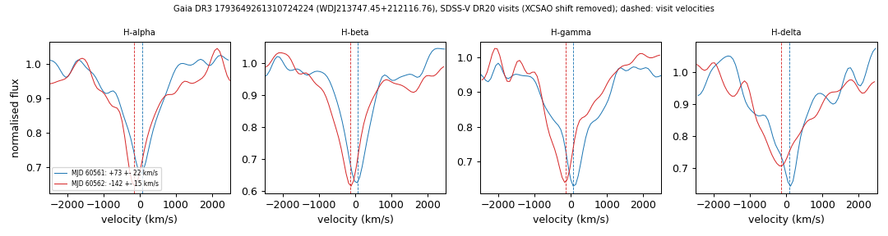

# Radial-velocity variable DA white dwarfs (double white dwarf candidates)

Four DA white dwarfs from a screen of 7,203 SDSS-V DR20 DA white dwarfs whose Balmer-line velocities change by 150 to 530 km/s between visits one night apart. The velocities are measured independently on the Astra visit spectra and on the BOSS pipeline per-exposure spectra. Changes of this size between nights are expected from orbital motion in a close binary; no companion is detected, and no periods are known.
- WDJ213747.45+212116.76 and WDJ202507.82+162431.33: the clearest Doppler shifts, seen in at least three Balmer lines.
- WDJ034434.04-453001.55 and WDJ055802.20+282814.84: noisier spectra, the largest velocity changes of the candidates, and photometric masses near 0.26 Msun, in the range of extremely-low-mass white dwarfs. Tables: `tables/rv_variable_da.csv` (summary), `tables/rv_variable_da_velocities.csv` (every visit, exposure and SDSS/DESI spectrum); script `scripts/rv_variable_da.py`; method below and in [METHODS.md](../METHODS.md#methods).

## Velocities

Velocities in km/s. SDSS-V: consensus of the Balmer lines in each in-stack visit after removing the XCSAO shift, corrected for the field-night zero point, with calibrated errors. BOSS: consensus per exposure of the BOSS v6_2_1 spec files (no Astra resampling, no XCSAO shift), with calibrated errors and a 9.3 km/s floor between visits.

| star | Gaia DR3 | G | M_G | GF21 Teff, log g, mass (H) | SDSS-V visits (MJD: v) | BOSS exposures (MJD: v) | change, significance |
|---|---|---|---|---|---|---|---|
| WDJ213747.45+212116.76 | 1793649261310724224 | 17.74 | 12.56 | 7.26 kK, 7.47, 0.36 Msun | 60561: +73 ± 22; 60562: -142 ± 15 | 60561.22: +61 ± 17; 60562.19: -148 ± 16 | 215 km/s, 8.2 sigma (BOSS 209 km/s, 9.2 sigma) |
| WDJ202507.82+162431.33 | 1805900191668352384 | 17.85 | 8.25 | no H solution (Pwd 0.21) | 60467: +113 ± 14; 60468: -39 ± 17 | 60467.37: +103 ± 15; 60468.33: -58 ± 19 | 152 km/s, 7.0 sigma (BOSS 161 km/s, 6.6 sigma) |
| WDJ034434.04-453001.55 | 4835899632154347520 | 18.88 | 10.07 | 12.8 kK, 6.99, 0.26 Msun | 60621: -117 ± 25; 60622: +342 ± 25 | 60621.29: -145 ± 52; 60621.31: -120 ± 49; 60622.22: +316 ± 62; 60622.24: +382 ± 58 | 458 km/s, 12.9 sigma (BOSS 527 km/s, 6.8 sigma) |
| WDJ055802.20+282814.84 | 3431502535327561728 | 18.34 | 9.49 | 18.4 kK, 6.88, 0.26 Msun | 60597: +374 ± 77; 60598: -149 ± 29 | 60597.42: +358 ± 54; 60598.50: -113 ± 34 | 523 km/s, 6.4 sigma (BOSS 472 km/s, 7.5 sigma) |

- log10 p of a constant velocity: SDSS-V -15.7, -11.7, -37.4, -9.8; BOSS -19.3, -10.3, -15.9, -13.1 (same order as the table).
- All visits are in_stack = True; all are SDSS-V DR20 epochs (MJD > 60130, after the last DR19 visit).
- WDJ034434.04-453001.55: H-alpha does not pass the line-quality cuts in either visit, so its velocities use H-beta, H-gamma and H-delta.
- WDJ055802.20+282814.84: one of the two BOSS exposures of MJD 60598 is dropped because its sky lines are offset by 34 km/s.
- WDJ213747.45+212116.76 also has a DESI DR1 spectrum (MJD 59372.46): H-alpha +79 ± 15, H-beta +86 ± 28 km/s (formal errors, own template).
- GF21: Gentile Fusillo et al. (2021) pure-H photometric fits.
- WDJ202507.82+162431.33 is more luminous than white dwarfs of its colour (M_G 8.25, BP-RP 0.23; GF21 Pwd 0.21). It may be an extremely-low-mass or pre-white-dwarf star.
- WDJ202507.82+162431.33, WDJ034434.04-453001.55 and WDJ055802.20+282814.84 are in the Pelisoli & Vos (2019) list of photometric extremely-low-mass white dwarf candidates (Gaia DR2), which gives no velocities.
- Gaia DR3 neighbours within 6 arcsec are both background stars:
  - Gaia DR3 1793649265604999808 (G 19.56, 2.83 arcsec from WDJ213747.45+212116.76, parallax 0.56 ± 0.35 mas);
  - Gaia DR3 3431502535327561856 (G 18.60, 5.89 arcsec from WDJ055802.20+282814.84, parallax 0.59 ± 0.19 mas).
- WDJ213747.45+212116.76 is listed in SUPERWIDE (Hartman & Lépine 2020) as the primary of a candidate wide pair.
- RUWE is 0.98-1.09 for all four; Gaia DR3 has no variability classification and no non-single-star solution for any of them.

**Periods.** None are known. The objects have two SDSS-V visits each. ZTF DR24 (1-5 c/d masked, `tables/rv_variable_da.csv`) shows no significant period:
- WDJ213747.45+212116.76: highest peak 24.30 c/d, false-alarm probability 6e-4;
- WDJ202507.82+162431.33: highest peak 2.10 c/d, 0.77;
- WDJ055802.20+282814.84: highest peak 98.52 c/d, 0.23;
- WDJ034434.04-453001.55 is outside the ZTF sky.

At G = 17.7-18.9 the stars are too faint for useful TESS light curves (not checked). The test for each star: a third and fourth epoch within one night, then an orbit from time-resolved spectroscopy.

**Novelty checks** (2026-10-18). No binary or velocity report for the four stars was found in:
- the SDSS-V DR19 double white dwarf catalogue (Adamane Pallathadka et al., arXiv:2509.02906, Table 3 of version 1);
- SIMBAD identifiers and references; VizieR all-table cones (3 arcsec, epochs 2016 and J2000), including the ELM Survey tables, SPY, Kilic et al. (2020) and the DESI EDR double white dwarfs of Jiang et al. (2025);
- the DESI DR1 white-dwarf catalogue (Swan et al. 2026) and the MWDD;
- arXiv sources searched by Gaia id, aliases and Jhhmm+ddmm names (search tested on a known object): DBL I and II (arXiv:2407.02594, 2507.14123), SPY (arXiv:1906.10977), Breedt et al. (2017), Kilic et al. (2025, arXiv:2412.04611), Chandra et al. (2021), the SDSS-V DA+DQ paper (arXiv:2507.11618), Kosakowski et al. (2023), Badenes & Maoz (2012), Maoz et al. (2012), Swan et al. (2026) and Crumpler et al. (2025);
- ADS full text for every alias; the ESO archive (no spectra).

## Screen

- **Sample.** SDSS-V DR20 objects with a SnowWhite class starting DA (or DBA, DAB; no MS or CV) and at least two visits with in_stack = True: 18,435 objects. 7,203 of them (23,446 visits) have at least two visits with S/N ≥ 8 and at least two consistent Balmer lines. Visits with in_stack = False (13% of all visits) were not used.
- **Velocities, calibration and zero points** as in `scripts/rv_variable_da.py`. The line error factors are 1.0-2.3 (rising with the error); after the consensus step they are 0.5-1.1. Field-night zero points use at least 5 objects on the same field and MJD.
- **Flag.** log10 p < -4, a pair difference above 3 sigma and above 50 km/s, and log10 p < -2 after dropping any one visit (or exactly two visits). 117 objects were flagged, 98 of them with M_G > 6.
- **Store against BOSS.** On the same visits (732 pairs) the median offset is +1.0 km/s. The robust width of the normalised differences is 0.49, so the store errors are conservative; 2.6% of pairs differ by more than 4 sigma.
- **Null test** (`tables/rv_variable_da_null.csv`). The H-alpha minus blue-line velocity difference of each visit has no orbital signal; the same flag applied to that series picks out 3 of 6,651 objects at S/N ≥ 8, about 3 false candidates expected among the 7,203. The flag on the velocities picks out 117.
- **Injections** (`tables/rv_variable_da_injection.csv`). 1,500 circular orbits (P log-uniform 0.01-30 d, K log-uniform 30-500 km/s, averaged over each visit) were injected into quiet objects. At S/N ≥ 8, 31% are recovered overall: 51% for K = 100-200 km/s and P = 1-10 d, 54-66% for K = 200-500 km/s at P > 0.1 d, and 4-21% for K < 100 km/s. Recovery drops at P < 0.1 d, where the velocity is averaged within a visit. Single-visit steps of +150 km/s are recovered at 149.1 km/s (robust width 4.7 km/s).
- **BOSS confirmation.** The 98 flagged objects were measured on BOSS exposures; 67 gave velocities and 22 are confirmed there. Of 87 random DA controls with M_G > 6, one is flagged.
- **Blind recovery of the DR19 catalogue** (`tables/rv_variable_da_dr19_recovery.csv`). Of the 63 objects of Adamane Pallathadka et al. (arXiv:2509.02906, Table 3 of version 1):
  - 53 are measurable in either route, and 19 of these are recovered (11 in the store route, 17 in the BOSS route);
  - 30 are not significant here. Most were found in DR19 from the velocity scatter between exposures of one visit, which the visit spectra average out, and the thresholds here are stricter;
  - 4 are below the threshold, 9 have no usable spectra, and 1 is not in DR20.
  - Of the known binaries outside DR19, J1236-0444 (ELM Survey South I) is recovered; GD 231 (P = 5.08 d) is below the threshold (log10 p = -3.4).
- **Dispositions** of the 98 flagged objects and one flagged control:
  - 2 are the candidates above and 5 are weaker candidates, including the two extremely-low-mass objects above;
  - 3 are weak;
  - 12 are already known (11 in DR19, 1 in the literature) and 4 were found in an earlier search;
  - 5 were rejected by eye and 36 excluded (not a white dwarf in GF21, magnetic, or main-sequence colours);
  - 32 have no BOSS support.

  Only the four stars on this page are reported.
- **Limits.** Visits with in_stack = False and a per-exposure sweep of all 18,435 objects were not used, so binaries with periods of hours are under-represented. Masses are photometric (GF21, pure H). The DR19 journal table could not be retrieved; version 1 on arXiv was used.

The screen tables (`rv_variable_da_injection.csv`, `rv_variable_da_null.csv`, `rv_variable_da_dr19_recovery.csv`) and the zero points and error calibration in `data/rv_variable_da_zero_points.csv` and `data/rv_variable_da_calibration.json` are exported from the full run and are not recomputed by the scripts.
